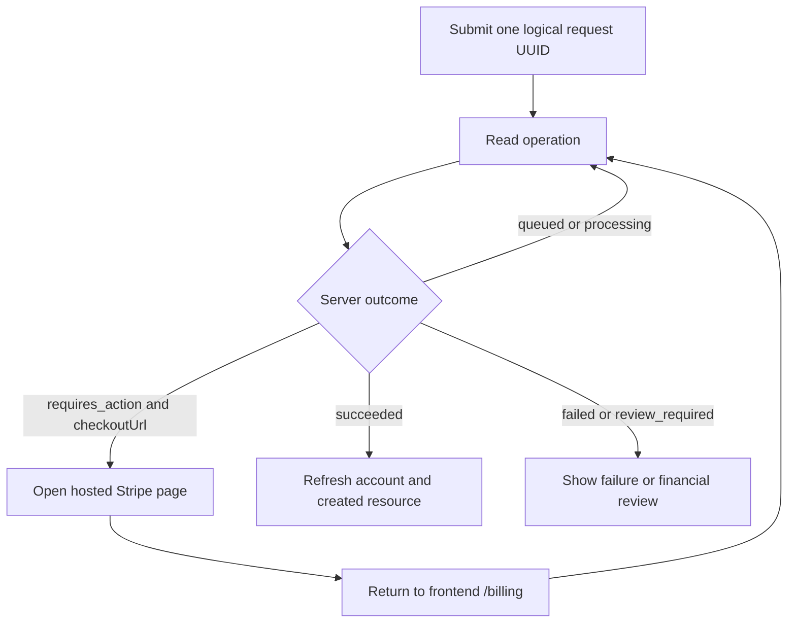

# 21 — Frontend integration for payments and subscriptions

Verified against the current compiled API on **7 November 2026**, including
V037 automatic inspection refunds. Implement this guide together with the
companion [BRD 19 integration guide](22-marketplace-updates.md), which supplies
the final discovery, physical-card and price-list rules.

The shared payment backend and Stripe web purchases are implemented. Apple App
Store and Google Play purchase verification, restoration and store notifications
remain pending. Web and mobile can read the same account's verified benefits.

## Connection, amounts and access

Use a configurable API origin. DEV is `https://dev-api-sp.auete.store`, the demo
is `https://dev-admin-sp.auete.store`, and the standalone SignalR hub is
`https://dev-signalr.auete.store/hubs/notifications`. Send the API JWT as a Bearer
token and read successful business responses from `data`.

Dates ending in `Utc` are UTC instants. Format them in the user's timezone.
Payment amounts ending in `Minor` are integer AUD cents, so `500` displays as
AUD 5.00. Catalogue/provider `price` fields use decimal AUD, explained in BRD 19.
Render descriptions, reasons and messages as plain text. Shared response,
error, paging and refresh contracts are in the [integration rules](00-integration-basics.md).

| Screen/action | Member permissions | Additional rules |
|---|---|---|
| Plans, own account, operations, confirmations, transactions and refunds | `payments.view` | Own records. Reads support profile-setup access. |
| Add a saved card, set default, subscribe or change plan | `payments.manage` | Full access. Purchases/setup require a completed member profile. |
| Remove a card or stop subscription renewal | `payments.delete` | Profile-setup access supported, with ownership/renewal-card checks. |
| Cancel an unpaid Checkout | `payments.delete` | Profile-setup access supported. Completed purchases follow their resource's cancellation flow. |
| Request a funded inspection | `payments.manage` and `inspections.manage` | Full access, completed profile and eligible discoverable service. |
| Cancel an inspection | `inspections.delete` | Participant ownership, valid state and scheduled-time cutoff. |
| Settings, plans, all-user financial records, grants and recovery | SuperAdmin | Explicit `/api/admin/payments` routes. |

Subscriptions and role permissions are cumulative. Drive paid-feature visibility
from `hasPriceListAccess` and `hasProviderVisibility` returned by the server.
Tradeperson is the only ordinary provider type. Keep business types separate
from roles and apply BRD 19's target-owner rules to administrative operations.

## Subscription screens and billing rules

Load `GET /api/payments/plans` and `GET /api/payments/me` together.

| Stable plan code | Eligible buyer | Benefits |
|---|---|---|
| `price_list` | Eligible members of any type | Shared Global price-list access. |
| `provider` | Tradeperson | Price-list access and visibility of the account's eligible service listings. |

Use returned plan names, descriptions and Stripe prices. Initial AUD 1/year and
AUD 50/year values are configurable. Respect `isAvailable`, `isEligible` and the
selected price's `isPublished`. One user has one active plan.

The account's nullable `subscription` contains `channel`, `planCode`, `status`,
`paidUntilUtc`, `cancelAtPeriodEnd`, `pendingPlanCode` and `renewalOffRequired`.
Display pending work separately from verified subscription state.

| Action/event | Frontend behavior |
|---|---|
| First successful purchase | Refresh account and gated queries. Annual term begins at purchase. |
| Upgrade `price_list` to `provider` | Explain Stripe's prorated difference and retained renewal date. Follow any returned hosted invoice URL. |
| Downgrade `provider` to `price_list` | Show the pending change for renewal. Use current verified benefits until then. |
| Cancel renewal | Show cancellation of renewal and retained paid access through term end. |
| Renewal failure | Show suspended benefits and recovery state. Stripe recovery runs for up to seven days. |
| Recovery payment succeeds | Refresh benefits to restore access. |
| Price increase | Display actual server/provider prices. Existing Stripe renewals follow the 30-day notice rule. |
| Change billing channel | Current renewal is cancelled and the paid term must end before purchasing through another channel. |
| Tradeperson changes type | Provider visibility ends, renewal stops and verified price-list access can continue through the paid term. |

Tradepeople can maintain eligible listings and annual provider prices without
a subscription. Discoverability requires the provider benefit. Requesting a
service requires no subscription. The backend/provider sends receipts and
queues the reminder during the three days before renewal.

## Shared Checkout and operation lifecycle



1. Generate a nonempty UUID per logical action. Persist its UUID and input
   across network retries, reload and redirect. Disable duplicate submission.
2. Explain the displayed one-time fee or recurring annual price and obtain
   explicit consent. New charging/card setup requires `consentAccepted: true`.
3. Submit and retain the returned operation `id`. HTTP 200 with `queued` means
   work was accepted. Payment outcome is determined by the verified server state.
4. Poll `GET /api/payments/operations/{id}`. A practical client interval is
   2–3 seconds, with backoff for 429 and pause/resume on visibility changes.
   This interval is a client design choice.
5. Navigate to the returned HTTPS `checkoutUrl` when available. Stripe collects
   card details directly. Upgrade authentication can use a hosted invoice URL.
6. Implement frontend `/billing`. Stripe returns `operationId` and a `checkout`
   query value. Resume polling there, including after cancel/back navigation.
7. On success, inspect the expected resource ID and `refundRequired`, then
   refresh account/resource data. A redirect can arrive before webhook processing.
8. Reuse the same UUID and identical input after an uncertain network outcome.
   Resolve the original operation before offering another purchase.

| Operation status | UI action |
|---|---|
| `queued`, `processing` | Show progress and poll the original operation. |
| `requires_action` | Offer/resume the returned `checkoutUrl`. |
| `succeeded` | Check kind, `inspectionId`, `cardRequestId` and `refundRequired`, then refetch. |
| `failed` | Show the failure and optional `errorCode`. Refresh state before a new attempt. |
| `review_required` | Show that SuperAdmin must investigate. Preserve the operation reference. |

Cancel an unpaid Checkout through
`POST /api/payments/operations/{id}/cancel`, with a new cancellation request UUID.
Poll that returned cancellation operation and refresh the original purchase.
If the purchase already succeeded, use the created resource's cancellation flow.

## Saved cards and purchase requests

`GET /api/payments/cards` returns brand, `last4`, expiry and `isDefault`.
Adding a card uses this setup request and the shared Checkout lifecycle.

```http
POST /api/payments/cards/setup
Content-Type: application/json
```

```json
{
  "requestId": "11111111-1111-4111-8111-111111111111",
  "consentAccepted": true
}
```

Setup saves a card without collecting an inspection fee. The added card becomes
default. Change it with `PUT /api/payments/cards/{id}/default`, without a body.
Remove it with `DELETE /api/payments/cards/{id}`. Removing the renewal card can
be refused until another default is selected or renewal is stopped.

| Action | Endpoint | Body fields |
|---|---|---|
| Purchase subscription | POST `/api/payments/subscriptions/checkout` | `requestId`, `consentAccepted`, `planCode`. |
| Change plan | POST `/api/payments/subscriptions/change` | Same fields. |
| Stop renewal | POST `/api/payments/subscriptions/cancel` | `requestId`, `consentAccepted` from `PaymentOperationRequest`. |

Complete examples and field validation appear in the generated reference below.

## Requesting an inspection

Read `/api/payments/me` when opening booking. Show the confirmation fee,
the separate informative inspection price and available complimentary count.
Respect `inspectionRequestsEnabled`. Billing setup is required for new member
inspection requests, including requests funded by a free unit.

```http
POST /api/payments/inspections/checkout
Content-Type: application/json
```

```json
{
  "requestId": "22222222-2222-4222-8222-222222222222",
  "serviceId": 101,
  "streetAddress": "10 Example Street",
  "suburb": "Sydney",
  "regionCode": "NSW",
  "postalCode": "2000",
  "note": "Please inspect the switchboard.",
  "consentAccepted": true
}
```

Replace sample IDs and reference codes with environment values. The requester
supplies the address for this visit.

| Funding/outcome | Result |
|---|---|
| Available complimentary confirmation | Oldest free unit is allocated. Operation can immediately succeed with `inspectionId`. No new charge or card setup is required. |
| No available free unit | Follow Checkout. Verified payment creates one pending inspection. |
| Charge succeeds but booking creation fails | `succeeded`, `refundRequired: true`, no `inspectionId`. Show automatic full refund and its history. |
| Checkout abandoned/failed/authentication pending | Display the payment outcome. A booking exists only once the API returns its inspection. |

The direct `POST /api/inspections` route consumes an available complimentary
unit and returns an inspection. The checkout route supports both free and paid
paths. A free unit can be used with `consentAccepted: false`; charging needs
explicit consent. One open inspection is allowed per requester/service.

After creation the provider accepts/schedules or rejects the pending request.
The platform collects the confirmation fee. The informative inspection price is
snapshotted on creation and stays outside the platform charge. QR/code completion
collects no additional fee.

## Automatic refunds and cancellation cutoff

| Outcome | Paid funding | Complimentary funding |
|---|---|---|
| Provider rejects | Automatic full original-payment refund. | Return the same unit. |
| Requester, provider or SuperAdmin cancels | Same full-refund policy. | Return the same unit. |
| Inspection completes/is rated | Funding is spent. | Unit is spent. |
| Legacy inspection without funded confirmation | Preserve history without inventing a paid refund. | Apply its existing history. |

Pending inspections remain cancellable by participants. For accepted inspections,
participants can cancel before `scheduledAtUtc`. At or after that instant,
SuperAdmin handles cancellation through
`POST /api/admin/inspections/{inspectionId}/decision`, action `cancel` and reason.
A late member cancellation returns HTTP 403.

Use `canCancel` and current status to control actions. Re-fetch after a rejected
transition. `refundId` and `refundStatus` are returned on inspection details to
the requester and SuperAdmin. Provider responses withhold those financial
references. Existing fields include `isLegacyBilling`, `confirmationId`,
`informativeInspectionPriceMinor`, `chargedNowMinor` and `currency`.

Read `/api/payments/refunds` for inspection refund history, `/confirmations`
for grants/funding history, and `/transactions` for collected/refunded amounts
and receipt links. List routes use `page`, `pageSize` and `hasMore`. Member reads
always use the authenticated owner even when a `userId` filter is supplied.

| Refund status | Frontend behavior |
|---|---|
| `processing` | Show automatic refund pending. Bank visibility can take longer than API processing. |
| `succeeded` | Show the full original amount returned. |
| `failed`, `review_required` | Show financial investigation state. Funding remains reserved. |
| Historical `rejected`, `withdrawn` | Display retained history. |

Refund records expose `isAutomatic`, `operationId` and `originalAmountMinor`.
Keep cancellation and refund states separate. An inspection can be cancelled
while its refund is processing. Repeated cancellation must leave one refund
or return the same free unit once.

`balance.availableComplimentary` is the spendable free inspection count.
`refundReserved` counts outstanding reserved paid funding. `availablePaid` is
a legacy compatibility field and must not be offered as new booking credit.
V037 queues eligible unused paid value and pending approvals for automatic refund.

Member POST `/api/payments/refunds`, DELETE `/api/payments/refunds/{id}` and
admin refund `/approve`/`/reject` actions have been removed. Implement refund
history and financial recovery instead of submission and approval controls.

## SuperAdmin billing screens

| Screen/action | Integration |
|---|---|
| Inspection billing settings | GET/PUT `/api/admin/payments/settings`. Submit complete mutable settings and an audit reason. |
| Stripe plan configuration | PUT `/api/admin/payments/plans/{code}`, with price in integer cents. |
| Member account | GET `/api/admin/payments/users/{id}`. |
| Financial history | GET `/api/admin/payments/confirmations`, `/transactions`, `/refunds`, `/operations`, `/audit`. Optional `userId` filters lists. |
| Grant free inspection units | POST `/api/admin/payments/confirmations/grant`, with `requestId`, `userId`, `count`, `reason`. |
| Revoke an unused free unit | POST `/api/admin/payments/confirmations/{id}/revoke`, with `reason`. |
| Recover an operation | POST `/api/admin/payments/operations/{id}/retry`, with `reason`, after investigation. |

Confirmation fee must be at least 50 cents. Informative price can be zero but
must be configured. `taxStatus` accepts `unconfigured`, `not_registered` or
`registered`; actual company tax setup is required before live charging.
Plan changes queue Stripe publication. Reload plans to show publication status.

Grants need a nonempty UUID, 1–1000 units and an audit reason. Free units belong
to their account and have no expiry. Revocation applies only to an unused unit.
Administrative inspection creation uses explicit complimentary funding/audit.

## Notifications, failures and acceptance

Consume SignalR `notificationReceived`. For `payment.*`, refresh visible account,
operation, transaction, confirmation and refund queries. For `inspection.*`,
refresh the inspection and its billing queries. Deduplicate notices by `eventId`.
Re-fetch on reconnect/app resume and keep polling open operations. Event payloads
carry invalidation references. Read authoritative state over HTTP. Configure
the current hub URL when following the [notification lifecycle guide](18-realtime-notifications.md).

| Failure | UI response |
|---|---|
| 400 `VALIDATION_FAILED` | Show field/business messages and refresh conflicting state. Reusing a UUID with changed input is invalid. |
| 401 | Use the normal coordinated refresh and retry once. |
| 403 | Explain permission, eligibility or cancellation-cutoff failure. |
| 404 | Show missing/inaccessible record. |
| 429 | Back off and retain the original operation UUID. |
| 503 `PAYMENTS_UNAVAILABLE` | Show temporary payment unavailability and preserve context. |
| Network timeout | Resolve the original operation before another purchase. |

Frontend acceptance should cover purchase, upgrade/downgrade, renewal
cancellation, redirect before webhook, reload during Checkout, duplicate submit,
paid/free inspections, cancellations by every actor, provider rejection,
scheduled-time cutoff, late admin cancellation, automatic refund failure/recovery
and successful payment followed by failed booking. Test missing permissions
and profile-setup access. Sample IDs/dates below are illustrative environment data.

<!-- GENERATED API REFERENCE: START -->

## Detailed API reference

Generated from the current compiled API. Read the workflow above and [shared conventions](00-integration-basics.md) first.

All success examples below are illustrative shapes, not captured production data. Replace example IDs, dates, credentials and catalogue codes with values returned by your environment.

All normal controller successes use HTTP 200. Errors can also be 400/401/403/404/429/500/503; see the shared error contract. A binary PDF download is documented separately from JSON.

### Endpoint summary

| Method and path | Access |
|---|---|
| [POST /api/admin/inspections/{inspectionId}/decision](#post-api-admin-inspections-inspectionid-decision) | Bearer JWT; Role: SuperAdmin; full access required |
| [GET /api/admin/payments/audit](#get-api-admin-payments-audit) | Bearer JWT; Role: SuperAdmin; full access required |
| [GET /api/admin/payments/confirmations](#get-api-admin-payments-confirmations) | Bearer JWT; Role: SuperAdmin; full access required |
| [POST /api/admin/payments/confirmations/{id}/revoke](#post-api-admin-payments-confirmations-id-revoke) | Bearer JWT; Role: SuperAdmin; full access required |
| [POST /api/admin/payments/confirmations/grant](#post-api-admin-payments-confirmations-grant) | Bearer JWT; Role: SuperAdmin; full access required |
| [GET /api/admin/payments/operations](#get-api-admin-payments-operations) | Bearer JWT; Role: SuperAdmin; full access required |
| [POST /api/admin/payments/operations/{id}/retry](#post-api-admin-payments-operations-id-retry) | Bearer JWT; Role: SuperAdmin; full access required |
| [PUT /api/admin/payments/plans/{code}](#put-api-admin-payments-plans-code) | Bearer JWT; Role: SuperAdmin; full access required |
| [GET /api/admin/payments/refunds](#get-api-admin-payments-refunds) | Bearer JWT; Role: SuperAdmin; full access required |
| [GET /api/admin/payments/settings](#get-api-admin-payments-settings) | Bearer JWT; Role: SuperAdmin; full access required |
| [PUT /api/admin/payments/settings](#put-api-admin-payments-settings) | Bearer JWT; Role: SuperAdmin; full access required |
| [GET /api/admin/payments/transactions](#get-api-admin-payments-transactions) | Bearer JWT; Role: SuperAdmin; full access required |
| [GET /api/admin/payments/users/{id}](#get-api-admin-payments-users-id) | Bearer JWT; Role: SuperAdmin; full access required |
| [GET /api/inspections/{inspectionId}](#get-api-inspections-inspectionid) | Bearer JWT; `inspections.view`; full access required |
| [POST /api/inspections/{inspectionId}/cancel](#post-api-inspections-inspectionid-cancel) | Bearer JWT; `inspections.delete`; full access required |
| [GET /api/payments/cards](#get-api-payments-cards) | Bearer JWT; `payments.view`; profile-setup access supported |
| [DELETE /api/payments/cards/{id}](#delete-api-payments-cards-id) | Bearer JWT; `payments.delete`; profile-setup access supported |
| [PUT /api/payments/cards/{id}/default](#put-api-payments-cards-id-default) | Bearer JWT; `payments.manage`; full access required |
| [POST /api/payments/cards/setup](#post-api-payments-cards-setup) | Bearer JWT; `payments.manage`; full access required |
| [GET /api/payments/confirmations](#get-api-payments-confirmations) | Bearer JWT; `payments.view`; profile-setup access supported |
| [POST /api/payments/inspections/checkout](#post-api-payments-inspections-checkout) | Bearer JWT; `payments.manage` AND `inspections.manage`; full access required |
| [GET /api/payments/me](#get-api-payments-me) | Bearer JWT; `payments.view`; profile-setup access supported |
| [GET /api/payments/operations/{id}](#get-api-payments-operations-id) | Bearer JWT; `payments.view`; profile-setup access supported |
| [POST /api/payments/operations/{id}/cancel](#post-api-payments-operations-id-cancel) | Bearer JWT; `payments.delete`; profile-setup access supported |
| [GET /api/payments/plans](#get-api-payments-plans) | Bearer JWT; `payments.view`; profile-setup access supported |
| [GET /api/payments/refunds](#get-api-payments-refunds) | Bearer JWT; `payments.view`; profile-setup access supported |
| [POST /api/payments/stripe/webhook](#post-api-payments-stripe-webhook) | Anonymous allowed |
| [POST /api/payments/subscriptions/cancel](#post-api-payments-subscriptions-cancel) | Bearer JWT; `payments.delete`; profile-setup access supported |
| [POST /api/payments/subscriptions/change](#post-api-payments-subscriptions-change) | Bearer JWT; `payments.manage`; full access required |
| [POST /api/payments/subscriptions/checkout](#post-api-payments-subscriptions-checkout) | Bearer JWT; `payments.manage`; full access required |
| [GET /api/payments/transactions](#get-api-payments-transactions) | Bearer JWT; `payments.view`; profile-setup access supported |

Authorization requirements are cumulative. Role/permission checks also have the ownership, state and eligibility rules described above. SuperAdmin bypasses permission policies; use explicit admin routes to target other accounts. Query parameter names are case-insensitive; the tables retain API Explorer spelling.

<a id="post-api-admin-inspections-inspectionid-decision"></a>
### `POST /api/admin/inspections/{inspectionId}/decision`

**Access:** Bearer JWT; Role: SuperAdmin; full access required.

| Parameter | In | Type | Required | Default / validation |
|---|---|---|---|---|
| `inspectionId` | path | integer (int64) | yes | — |

**Request:** `application/json`; [AdminInspectionDecisionRequest](#model-admininspectiondecisionrequest).

```json
{
  "action": "accept",
  "scheduledAt": "2030-01-15T10:00:00+11:00",
  "reason": "Reviewed and confirmed by the administrator."
}
```

**Success:** HTTP 200; [InspectionResponseApiResponse](#model-inspectionresponseapiresponse).

<details>
<summary>Illustrative success response</summary>

```json
{
  "traceId": "example-trace-id",
  "code": "Success",
  "data": {
    "canCancel": true,
    "refundId": null,
    "refundStatus": null,
    "isLegacyBilling": false,
    "confirmationId": null,
    "informativeInspectionPriceMinor": null,
    "chargedNowMinor": 1,
    "currency": "aud",
    "id": 101,
    "serviceId": 101,
    "requesterUserId": 101,
    "providerUserId": 101,
    "businessId": 101,
    "serviceTitle": "example",
    "occupationCode": "electrical_services",
    "occupationName": "example",
    "businessName": "Example Electrical",
    "providerName": "example",
    "providerMembershipId": "example",
    "requesterName": "example",
    "requesterMembershipId": "example",
    "requesterMobilePhone": "example",
    "visitAddress": {
      "streetAddress": "10 Example Street",
      "suburb": "Sydney",
      "regionCode": "NSW",
      "postalCode": "2000"
    },
    "requestNote": null,
    "status": "accepted",
    "scheduledAtUtc": "2030-01-14T23:00:00Z",
    "acceptedAtUtc": "2026-10-18T12:00:00Z",
    "completedAtUtc": null,
    "ratingScore": null,
    "ratingNote": null,
    "ratedAtUtc": null,
    "isHidden": false,
    "assignedEmployee": null,
    "employeeAssignmentHistory": [
      {
        "employeeId": 101,
        "name": "Example item",
        "occupationCode": "electrical_services",
        "occupationName": "example",
        "positionCode": null,
        "positionName": null,
        "actorUserId": 101,
        "assignedAtUtc": "2026-10-18T12:00:00Z",
        "endedAtUtc": null,
        "endReason": null
      }
    ],
    "createdAtUtc": "2026-10-18T12:00:00Z",
    "updatedAtUtc": "2026-10-18T12:00:00Z",
    "history": [
      {
        "actorUserId": 101,
        "action": "decide",
        "previousStatus": null,
        "status": "accepted",
        "note": null,
        "createdAtUtc": "2026-10-18T12:00:00Z"
      }
    ]
  }
}
```

</details>

<a id="get-api-admin-payments-audit"></a>
### `GET /api/admin/payments/audit`

**Access:** Bearer JWT; Role: SuperAdmin; full access required.

| Parameter | In | Type | Required | Default / validation |
|---|---|---|---|---|
| `UserId` | query | integer (int64) | no | minimum: 1; maximum: 9.223372036854776e+18; range 1–9.223372036854776E+18 |
| `Page` | query | integer (int32) | no | default: `1`; minimum: 1; maximum: 1000; range 1–1000 |
| `PageSize` | query | integer (int32) | no | default: `20`; minimum: 1; maximum: 100; range 1–100 |

**Request body:** none.

**Success:** HTTP 200; [PaymentAuditResponsePagedResponseApiResponse](#model-paymentauditresponsepagedresponseapiresponse).

<details>
<summary>Illustrative success response</summary>

```json
{
  "traceId": "example-trace-id",
  "code": "Success",
  "data": {
    "items": [
      {
        "id": 101,
        "userId": null,
        "actorUserId": null,
        "action": "example",
        "reason": null,
        "data": {},
        "createdAtUtc": "2026-10-18T12:00:00Z"
      }
    ],
    "page": 1,
    "pageSize": 20,
    "hasMore": false
  }
}
```

</details>

<a id="get-api-admin-payments-confirmations"></a>
### `GET /api/admin/payments/confirmations`

**Access:** Bearer JWT; Role: SuperAdmin; full access required.

| Parameter | In | Type | Required | Default / validation |
|---|---|---|---|---|
| `UserId` | query | integer (int64) | no | minimum: 1; maximum: 9.223372036854776e+18; range 1–9.223372036854776E+18 |
| `Page` | query | integer (int32) | no | default: `1`; minimum: 1; maximum: 1000; range 1–1000 |
| `PageSize` | query | integer (int32) | no | default: `20`; minimum: 1; maximum: 100; range 1–100 |

**Request body:** none.

**Success:** HTTP 200; [ConfirmationResponsePagedResponseApiResponse](#model-confirmationresponsepagedresponseapiresponse).

<details>
<summary>Illustrative success response</summary>

```json
{
  "traceId": "example-trace-id",
  "code": "Success",
  "data": {
    "items": [
      {
        "id": 101,
        "userId": 101,
        "source": "complimentary",
        "status": "available",
        "originalAmountMinor": null,
        "currency": "aud",
        "createdAtUtc": "2026-10-18T12:00:00Z",
        "updatedAtUtc": "2026-10-18T12:00:00Z"
      }
    ],
    "page": 1,
    "pageSize": 20,
    "hasMore": false
  }
}
```

</details>

<a id="post-api-admin-payments-confirmations-id-revoke"></a>
### `POST /api/admin/payments/confirmations/{id}/revoke`

**Access:** Bearer JWT; Role: SuperAdmin; full access required.

| Parameter | In | Type | Required | Default / validation |
|---|---|---|---|---|
| `id` | path | integer (int64) | yes | — |

**Request:** `application/json`; [PaymentReasonRequest](#model-paymentreasonrequest).

```json
{
  "reason": "Reviewed and confirmed by the administrator."
}
```

**Success:** HTTP 200; [ConfirmationResponseApiResponse](#model-confirmationresponseapiresponse).

<details>
<summary>Illustrative success response</summary>

```json
{
  "traceId": "example-trace-id",
  "code": "Success",
  "data": {
    "id": 101,
    "userId": 101,
    "source": "complimentary",
    "status": "available",
    "originalAmountMinor": null,
    "currency": "aud",
    "createdAtUtc": "2026-10-18T12:00:00Z",
    "updatedAtUtc": "2026-10-18T12:00:00Z"
  }
}
```

</details>

<a id="post-api-admin-payments-confirmations-grant"></a>
### `POST /api/admin/payments/confirmations/grant`

**Access:** Bearer JWT; Role: SuperAdmin; full access required.

**Request:** `application/json`; [GrantConfirmationsRequest](#model-grantconfirmationsrequest).

```json
{
  "requestId": "11111111-1111-4111-8111-111111111111",
  "userId": 101,
  "count": 2,
  "reason": "Reviewed and confirmed by the administrator."
}
```

**Success:** HTTP 200; [PaymentAccountResponseApiResponse](#model-paymentaccountresponseapiresponse).

<details>
<summary>Illustrative success response</summary>

```json
{
  "traceId": "example-trace-id",
  "code": "Success",
  "data": {
    "userId": 101,
    "hasStripeCustomer": false,
    "hasPriceListAccess": false,
    "hasProviderVisibility": false,
    "confirmationFeeMinor": null,
    "informativeInspectionPriceMinor": null,
    "inspectionRequestsEnabled": false,
    "subscription": null,
    "balance": {
      "availablePaid": 0,
      "availableComplimentary": 2,
      "refundReserved": 0
    }
  }
}
```

</details>

<a id="get-api-admin-payments-operations"></a>
### `GET /api/admin/payments/operations`

**Access:** Bearer JWT; Role: SuperAdmin; full access required.

| Parameter | In | Type | Required | Default / validation |
|---|---|---|---|---|
| `UserId` | query | integer (int64) | no | minimum: 1; maximum: 9.223372036854776e+18; range 1–9.223372036854776E+18 |
| `Page` | query | integer (int32) | no | default: `1`; minimum: 1; maximum: 1000; range 1–1000 |
| `PageSize` | query | integer (int32) | no | default: `20`; minimum: 1; maximum: 100; range 1–100 |

**Request body:** none.

**Success:** HTTP 200; [PaymentOperationResponsePagedResponseApiResponse](#model-paymentoperationresponsepagedresponseapiresponse).

<details>
<summary>Illustrative success response</summary>

```json
{
  "traceId": "example-trace-id",
  "code": "Success",
  "data": {
    "items": [
      {
        "id": "11111111-1111-4111-8111-111111111111",
        "kind": "inspection_checkout",
        "status": "queued",
        "checkoutUrl": null,
        "inspectionId": null,
        "cardRequestId": null,
        "refundRequired": false,
        "errorCode": null,
        "createdAtUtc": "2026-10-18T12:00:00Z",
        "updatedAtUtc": "2026-10-18T12:00:00Z"
      }
    ],
    "page": 1,
    "pageSize": 20,
    "hasMore": false
  }
}
```

</details>

<a id="post-api-admin-payments-operations-id-retry"></a>
### `POST /api/admin/payments/operations/{id}/retry`

**Access:** Bearer JWT; Role: SuperAdmin; full access required.

| Parameter | In | Type | Required | Default / validation |
|---|---|---|---|---|
| `id` | path | string (uuid) | yes | — |

**Request:** `application/json`; [PaymentReasonRequest](#model-paymentreasonrequest).

```json
{
  "reason": "Reviewed and confirmed by the administrator."
}
```

**Success:** HTTP 200; [PaymentOperationResponseApiResponse](#model-paymentoperationresponseapiresponse).

<details>
<summary>Illustrative success response</summary>

```json
{
  "traceId": "example-trace-id",
  "code": "Success",
  "data": {
    "id": "11111111-1111-4111-8111-111111111111",
    "kind": "inspection_checkout",
    "status": "queued",
    "checkoutUrl": null,
    "inspectionId": null,
    "cardRequestId": null,
    "refundRequired": false,
    "errorCode": null,
    "createdAtUtc": "2026-10-18T12:00:00Z",
    "updatedAtUtc": "2026-10-18T12:00:00Z"
  }
}
```

</details>

<a id="put-api-admin-payments-plans-code"></a>
### `PUT /api/admin/payments/plans/{code}`

**Access:** Bearer JWT; Role: SuperAdmin; full access required.

| Parameter | In | Type | Required | Default / validation |
|---|---|---|---|---|
| `code` | path | string | yes | — |

**Request:** `application/json`; [UpdatePaymentPlanRequest](#model-updatepaymentplanrequest).

```json
{
  "name": "Price List Access",
  "description": "Yearly shared price list access.",
  "isAvailable": true,
  "amountMinor": 100,
  "reason": "Reviewed and confirmed by the administrator."
}
```

**Success:** HTTP 200; [PaymentPlanResponseIReadOnlyListApiResponse](#model-paymentplanresponseireadonlylistapiresponse).

<details>
<summary>Illustrative success response</summary>

```json
{
  "traceId": "example-trace-id",
  "code": "Success",
  "data": [
    {
      "code": "price_list",
      "name": "Price List Access",
      "description": "Example description of the work.",
      "isAvailable": true,
      "isEligible": true,
      "prices": [
        {
          "id": 101,
          "channel": "stripe",
          "amountMinor": 100,
          "currency": "aud",
          "isPublished": true,
          "createdAtUtc": "2026-10-18T12:00:00Z"
        }
      ]
    }
  ]
}
```

</details>

<a id="get-api-admin-payments-refunds"></a>
### `GET /api/admin/payments/refunds`

**Access:** Bearer JWT; Role: SuperAdmin; full access required.

| Parameter | In | Type | Required | Default / validation |
|---|---|---|---|---|
| `UserId` | query | integer (int64) | no | minimum: 1; maximum: 9.223372036854776e+18; range 1–9.223372036854776E+18 |
| `Page` | query | integer (int32) | no | default: `1`; minimum: 1; maximum: 1000; range 1–1000 |
| `PageSize` | query | integer (int32) | no | default: `20`; minimum: 1; maximum: 100; range 1–100 |

**Request body:** none.

**Success:** HTTP 200; [ConfirmationRefundResponsePagedResponseApiResponse](#model-confirmationrefundresponsepagedresponseapiresponse).

<details>
<summary>Illustrative success response</summary>

```json
{
  "traceId": "example-trace-id",
  "code": "Success",
  "data": {
    "items": [
      {
        "isAutomatic": true,
        "operationId": "11111111-1111-4111-8111-111111111111",
        "id": 101,
        "userId": 101,
        "confirmationId": 101,
        "status": "processing",
        "reason": "Inspection cancelled",
        "decisionReason": null,
        "decidedByUserId": null,
        "originalAmountMinor": 500,
        "currency": "aud",
        "createdAtUtc": "2026-10-18T12:00:00Z",
        "updatedAtUtc": "2026-10-18T12:00:00Z"
      }
    ],
    "page": 1,
    "pageSize": 20,
    "hasMore": false
  }
}
```

</details>

<a id="get-api-admin-payments-settings"></a>
### `GET /api/admin/payments/settings`

**Access:** Bearer JWT; Role: SuperAdmin; full access required.

**Request body:** none.

**Success:** HTTP 200; [PaymentSettingsResponseApiResponse](#model-paymentsettingsresponseapiresponse).

<details>
<summary>Illustrative success response</summary>

```json
{
  "traceId": "example-trace-id",
  "code": "Success",
  "data": {
    "inspectionRequestsEnabled": false,
    "confirmationFeeMinor": null,
    "informativeInspectionPriceMinor": null,
    "taxStatus": "unconfigured",
    "updatedAtUtc": "2026-10-18T12:00:00Z"
  }
}
```

</details>

<a id="put-api-admin-payments-settings"></a>
### `PUT /api/admin/payments/settings`

**Access:** Bearer JWT; Role: SuperAdmin; full access required.

**Request:** `application/json`; [UpdatePaymentSettingsRequest](#model-updatepaymentsettingsrequest).

```json
{
  "inspectionRequestsEnabled": true,
  "confirmationFeeMinor": 500,
  "informativeInspectionPriceMinor": 10000,
  "taxStatus": "unconfigured",
  "reason": "Reviewed and confirmed by the administrator."
}
```

**Success:** HTTP 200; [PaymentSettingsResponseApiResponse](#model-paymentsettingsresponseapiresponse).

<details>
<summary>Illustrative success response</summary>

```json
{
  "traceId": "example-trace-id",
  "code": "Success",
  "data": {
    "inspectionRequestsEnabled": false,
    "confirmationFeeMinor": null,
    "informativeInspectionPriceMinor": null,
    "taxStatus": "unconfigured",
    "updatedAtUtc": "2026-10-18T12:00:00Z"
  }
}
```

</details>

<a id="get-api-admin-payments-transactions"></a>
### `GET /api/admin/payments/transactions`

**Access:** Bearer JWT; Role: SuperAdmin; full access required.

| Parameter | In | Type | Required | Default / validation |
|---|---|---|---|---|
| `UserId` | query | integer (int64) | no | minimum: 1; maximum: 9.223372036854776e+18; range 1–9.223372036854776E+18 |
| `Page` | query | integer (int32) | no | default: `1`; minimum: 1; maximum: 1000; range 1–1000 |
| `PageSize` | query | integer (int32) | no | default: `20`; minimum: 1; maximum: 100; range 1–100 |

**Request body:** none.

**Success:** HTTP 200; [PaymentTransactionResponsePagedResponseApiResponse](#model-paymenttransactionresponsepagedresponseapiresponse).

<details>
<summary>Illustrative success response</summary>

```json
{
  "traceId": "example-trace-id",
  "code": "Success",
  "data": {
    "items": [
      {
        "id": 101,
        "userId": 101,
        "purpose": "confirmation",
        "amountMinor": 500,
        "refundedMinor": 0,
        "isDisputed": false,
        "currency": "aud",
        "receiptUrl": null,
        "createdAtUtc": "2026-10-18T12:00:00Z"
      }
    ],
    "page": 1,
    "pageSize": 20,
    "hasMore": false
  }
}
```

</details>

<a id="get-api-admin-payments-users-id"></a>
### `GET /api/admin/payments/users/{id}`

**Access:** Bearer JWT; Role: SuperAdmin; full access required.

| Parameter | In | Type | Required | Default / validation |
|---|---|---|---|---|
| `id` | path | integer (int64) | yes | — |

**Request body:** none.

**Success:** HTTP 200; [PaymentAccountResponseApiResponse](#model-paymentaccountresponseapiresponse).

<details>
<summary>Illustrative success response</summary>

```json
{
  "traceId": "example-trace-id",
  "code": "Success",
  "data": {
    "userId": 101,
    "hasStripeCustomer": false,
    "hasPriceListAccess": false,
    "hasProviderVisibility": false,
    "confirmationFeeMinor": null,
    "informativeInspectionPriceMinor": null,
    "inspectionRequestsEnabled": false,
    "subscription": null,
    "balance": {
      "availablePaid": 0,
      "availableComplimentary": 1,
      "refundReserved": 0
    }
  }
}
```

</details>

<a id="get-api-inspections-inspectionid"></a>
### `GET /api/inspections/{inspectionId}`

**Access:** Bearer JWT; `inspections.view`; full access required.

| Parameter | In | Type | Required | Default / validation |
|---|---|---|---|---|
| `inspectionId` | path | integer (int64) | yes | — |

**Request body:** none.

**Success:** HTTP 200; [InspectionResponseApiResponse](#model-inspectionresponseapiresponse).

<details>
<summary>Illustrative success response</summary>

```json
{
  "traceId": "example-trace-id",
  "code": "Success",
  "data": {
    "canCancel": true,
    "refundId": null,
    "refundStatus": null,
    "isLegacyBilling": false,
    "confirmationId": null,
    "informativeInspectionPriceMinor": null,
    "chargedNowMinor": 1,
    "currency": "aud",
    "id": 101,
    "serviceId": 101,
    "requesterUserId": 101,
    "providerUserId": 101,
    "businessId": 101,
    "serviceTitle": "example",
    "occupationCode": "electrical_services",
    "occupationName": "example",
    "businessName": "Example Electrical",
    "providerName": "example",
    "providerMembershipId": "example",
    "requesterName": "example",
    "requesterMembershipId": "example",
    "requesterMobilePhone": "example",
    "visitAddress": {
      "streetAddress": "10 Example Street",
      "suburb": "Sydney",
      "regionCode": "NSW",
      "postalCode": "2000"
    },
    "requestNote": null,
    "status": "pending",
    "scheduledAtUtc": null,
    "acceptedAtUtc": null,
    "completedAtUtc": null,
    "ratingScore": null,
    "ratingNote": null,
    "ratedAtUtc": null,
    "isHidden": false,
    "assignedEmployee": null,
    "employeeAssignmentHistory": [
      {
        "employeeId": 101,
        "name": "Example item",
        "occupationCode": "electrical_services",
        "occupationName": "example",
        "positionCode": null,
        "positionName": null,
        "actorUserId": 101,
        "assignedAtUtc": "2026-10-18T12:00:00Z",
        "endedAtUtc": null,
        "endReason": null
      }
    ],
    "createdAtUtc": "2026-10-18T12:00:00Z",
    "updatedAtUtc": "2026-10-18T12:00:00Z",
    "history": [
      {
        "actorUserId": 101,
        "action": "requested",
        "previousStatus": null,
        "status": "pending",
        "note": null,
        "createdAtUtc": "2026-10-18T12:00:00Z"
      }
    ]
  }
}
```

</details>

<a id="post-api-inspections-inspectionid-cancel"></a>
### `POST /api/inspections/{inspectionId}/cancel`

**Access:** Bearer JWT; `inspections.delete`; full access required.

| Parameter | In | Type | Required | Default / validation |
|---|---|---|---|---|
| `inspectionId` | path | integer (int64) | yes | — |

**Request:** `application/json`; [InspectionReasonRequest](#model-inspectionreasonrequest).

```json
{}
```

**Success:** HTTP 200; [InspectionResponseApiResponse](#model-inspectionresponseapiresponse).

<details>
<summary>Illustrative success response</summary>

```json
{
  "traceId": "example-trace-id",
  "code": "Success",
  "data": {
    "canCancel": false,
    "refundId": null,
    "refundStatus": null,
    "isLegacyBilling": false,
    "confirmationId": null,
    "informativeInspectionPriceMinor": null,
    "chargedNowMinor": 1,
    "currency": "aud",
    "id": 101,
    "serviceId": 101,
    "requesterUserId": 101,
    "providerUserId": 101,
    "businessId": 101,
    "serviceTitle": "example",
    "occupationCode": "electrical_services",
    "occupationName": "example",
    "businessName": "Example Electrical",
    "providerName": "example",
    "providerMembershipId": "example",
    "requesterName": "example",
    "requesterMembershipId": "example",
    "requesterMobilePhone": "example",
    "visitAddress": {
      "streetAddress": "10 Example Street",
      "suburb": "Sydney",
      "regionCode": "NSW",
      "postalCode": "2000"
    },
    "requestNote": null,
    "status": "cancelled",
    "scheduledAtUtc": null,
    "acceptedAtUtc": null,
    "completedAtUtc": null,
    "ratingScore": null,
    "ratingNote": null,
    "ratedAtUtc": null,
    "isHidden": false,
    "assignedEmployee": null,
    "employeeAssignmentHistory": [
      {
        "employeeId": 101,
        "name": "Example item",
        "occupationCode": "electrical_services",
        "occupationName": "example",
        "positionCode": null,
        "positionName": null,
        "actorUserId": 101,
        "assignedAtUtc": "2026-10-18T12:00:00Z",
        "endedAtUtc": null,
        "endReason": null
      }
    ],
    "createdAtUtc": "2026-10-18T12:00:00Z",
    "updatedAtUtc": "2026-10-18T12:00:00Z",
    "history": [
      {
        "actorUserId": 101,
        "action": "cancel",
        "previousStatus": null,
        "status": "cancelled",
        "note": null,
        "createdAtUtc": "2026-10-18T12:00:00Z"
      }
    ]
  }
}
```

</details>

<a id="get-api-payments-cards"></a>
### `GET /api/payments/cards`

**Access:** Bearer JWT; `payments.view`; profile-setup access supported.

**Request body:** none.

**Success:** HTTP 200; [SavedCardResponseIReadOnlyListApiResponse](#model-savedcardresponseireadonlylistapiresponse).

<details>
<summary>Illustrative success response</summary>

```json
{
  "traceId": "example-trace-id",
  "code": "Success",
  "data": [
    {
      "id": "example",
      "brand": "visa",
      "last4": "4242",
      "expMonth": 12,
      "expYear": 2030,
      "isDefault": false
    }
  ]
}
```

</details>

<a id="delete-api-payments-cards-id"></a>
### `DELETE /api/payments/cards/{id}`

**Access:** Bearer JWT; `payments.delete`; profile-setup access supported.

| Parameter | In | Type | Required | Default / validation |
|---|---|---|---|---|
| `id` | path | string | yes | — |

**Request body:** none.

**Success:** HTTP 200; [BooleanApiResponse](#model-booleanapiresponse).

<details>
<summary>Illustrative success response</summary>

```json
{
  "traceId": "example-trace-id",
  "code": "Success",
  "data": true
}
```

</details>

<a id="put-api-payments-cards-id-default"></a>
### `PUT /api/payments/cards/{id}/default`

**Access:** Bearer JWT; `payments.manage`; full access required.

| Parameter | In | Type | Required | Default / validation |
|---|---|---|---|---|
| `id` | path | string | yes | — |

**Request body:** none.

**Success:** HTTP 200; [BooleanApiResponse](#model-booleanapiresponse).

<details>
<summary>Illustrative success response</summary>

```json
{
  "traceId": "example-trace-id",
  "code": "Success",
  "data": true
}
```

</details>

<a id="post-api-payments-cards-setup"></a>
### `POST /api/payments/cards/setup`

**Access:** Bearer JWT; `payments.manage`; full access required.

**Request:** `application/json`; [PaymentOperationRequest](#model-paymentoperationrequest).

```json
{
  "requestId": "11111111-1111-4111-8111-111111111111",
  "consentAccepted": true
}
```

**Success:** HTTP 200; [PaymentOperationResponseApiResponse](#model-paymentoperationresponseapiresponse).

<details>
<summary>Illustrative success response</summary>

```json
{
  "traceId": "example-trace-id",
  "code": "Success",
  "data": {
    "id": "11111111-1111-4111-8111-111111111111",
    "kind": "setup_checkout",
    "status": "queued",
    "checkoutUrl": null,
    "inspectionId": null,
    "cardRequestId": null,
    "refundRequired": false,
    "errorCode": null,
    "createdAtUtc": "2026-10-18T12:00:00Z",
    "updatedAtUtc": "2026-10-18T12:00:00Z"
  }
}
```

</details>

<a id="get-api-payments-confirmations"></a>
### `GET /api/payments/confirmations`

**Access:** Bearer JWT; `payments.view`; profile-setup access supported.

| Parameter | In | Type | Required | Default / validation |
|---|---|---|---|---|
| `UserId` | query | integer (int64) | no | minimum: 1; maximum: 9.223372036854776e+18; range 1–9.223372036854776E+18 |
| `Page` | query | integer (int32) | no | default: `1`; minimum: 1; maximum: 1000; range 1–1000 |
| `PageSize` | query | integer (int32) | no | default: `20`; minimum: 1; maximum: 100; range 1–100 |

**Request body:** none.

**Success:** HTTP 200; [ConfirmationResponsePagedResponseApiResponse](#model-confirmationresponsepagedresponseapiresponse).

<details>
<summary>Illustrative success response</summary>

```json
{
  "traceId": "example-trace-id",
  "code": "Success",
  "data": {
    "items": [
      {
        "id": 101,
        "userId": 101,
        "source": "complimentary",
        "status": "available",
        "originalAmountMinor": null,
        "currency": "aud",
        "createdAtUtc": "2026-10-18T12:00:00Z",
        "updatedAtUtc": "2026-10-18T12:00:00Z"
      }
    ],
    "page": 1,
    "pageSize": 20,
    "hasMore": false
  }
}
```

</details>

<a id="post-api-payments-inspections-checkout"></a>
### `POST /api/payments/inspections/checkout`

**Access:** Bearer JWT; `payments.manage` AND `inspections.manage`; full access required.

**Request:** `application/json`; [InspectionPaymentRequest](#model-inspectionpaymentrequest).

```json
{
  "serviceId": 101,
  "streetAddress": "10 Example Street",
  "suburb": "Sydney",
  "regionCode": "NSW",
  "postalCode": "2000",
  "requestId": "11111111-1111-4111-8111-111111111111",
  "consentAccepted": true
}
```

**Success:** HTTP 200; [PaymentOperationResponseApiResponse](#model-paymentoperationresponseapiresponse).

<details>
<summary>Illustrative success response</summary>

```json
{
  "traceId": "example-trace-id",
  "code": "Success",
  "data": {
    "id": "11111111-1111-4111-8111-111111111111",
    "kind": "inspection_checkout",
    "status": "queued",
    "checkoutUrl": null,
    "inspectionId": null,
    "cardRequestId": null,
    "refundRequired": false,
    "errorCode": null,
    "createdAtUtc": "2026-10-18T12:00:00Z",
    "updatedAtUtc": "2026-10-18T12:00:00Z"
  }
}
```

</details>

<a id="get-api-payments-me"></a>
### `GET /api/payments/me`

**Access:** Bearer JWT; `payments.view`; profile-setup access supported.

**Request body:** none.

**Success:** HTTP 200; [PaymentAccountResponseApiResponse](#model-paymentaccountresponseapiresponse).

<details>
<summary>Illustrative success response</summary>

```json
{
  "traceId": "example-trace-id",
  "code": "Success",
  "data": {
    "userId": 101,
    "hasStripeCustomer": false,
    "hasPriceListAccess": false,
    "hasProviderVisibility": false,
    "confirmationFeeMinor": null,
    "informativeInspectionPriceMinor": null,
    "inspectionRequestsEnabled": false,
    "subscription": null,
    "balance": {
      "availablePaid": 0,
      "availableComplimentary": 1,
      "refundReserved": 0
    }
  }
}
```

</details>

<a id="get-api-payments-operations-id"></a>
### `GET /api/payments/operations/{id}`

**Access:** Bearer JWT; `payments.view`; profile-setup access supported.

| Parameter | In | Type | Required | Default / validation |
|---|---|---|---|---|
| `id` | path | string (uuid) | yes | — |

**Request body:** none.

**Success:** HTTP 200; [PaymentOperationResponseApiResponse](#model-paymentoperationresponseapiresponse).

<details>
<summary>Illustrative success response</summary>

```json
{
  "traceId": "example-trace-id",
  "code": "Success",
  "data": {
    "id": "11111111-1111-4111-8111-111111111111",
    "kind": "inspection_checkout",
    "status": "queued",
    "checkoutUrl": null,
    "inspectionId": null,
    "cardRequestId": null,
    "refundRequired": false,
    "errorCode": null,
    "createdAtUtc": "2026-10-18T12:00:00Z",
    "updatedAtUtc": "2026-10-18T12:00:00Z"
  }
}
```

</details>

<a id="post-api-payments-operations-id-cancel"></a>
### `POST /api/payments/operations/{id}/cancel`

**Access:** Bearer JWT; `payments.delete`; profile-setup access supported.

| Parameter | In | Type | Required | Default / validation |
|---|---|---|---|---|
| `id` | path | string (uuid) | yes | — |

**Request:** `application/json`; [PaymentOperationRequest](#model-paymentoperationrequest).

```json
{
  "requestId": "11111111-1111-4111-8111-111111111111",
  "consentAccepted": true
}
```

**Success:** HTTP 200; [PaymentOperationResponseApiResponse](#model-paymentoperationresponseapiresponse).

<details>
<summary>Illustrative success response</summary>

```json
{
  "traceId": "example-trace-id",
  "code": "Success",
  "data": {
    "id": "11111111-1111-4111-8111-111111111111",
    "kind": "cancel_checkout",
    "status": "queued",
    "checkoutUrl": null,
    "inspectionId": null,
    "cardRequestId": null,
    "refundRequired": false,
    "errorCode": null,
    "createdAtUtc": "2026-10-18T12:00:00Z",
    "updatedAtUtc": "2026-10-18T12:00:00Z"
  }
}
```

</details>

<a id="get-api-payments-plans"></a>
### `GET /api/payments/plans`

**Access:** Bearer JWT; `payments.view`; profile-setup access supported.

**Request body:** none.

**Success:** HTTP 200; [PaymentPlanResponseIReadOnlyListApiResponse](#model-paymentplanresponseireadonlylistapiresponse).

<details>
<summary>Illustrative success response</summary>

```json
{
  "traceId": "example-trace-id",
  "code": "Success",
  "data": [
    {
      "code": "price_list",
      "name": "Price List Access",
      "description": "Example description of the work.",
      "isAvailable": true,
      "isEligible": true,
      "prices": [
        {
          "id": 101,
          "channel": "stripe",
          "amountMinor": 100,
          "currency": "aud",
          "isPublished": true,
          "createdAtUtc": "2026-10-18T12:00:00Z"
        }
      ]
    }
  ]
}
```

</details>

<a id="get-api-payments-refunds"></a>
### `GET /api/payments/refunds`

**Access:** Bearer JWT; `payments.view`; profile-setup access supported.

| Parameter | In | Type | Required | Default / validation |
|---|---|---|---|---|
| `UserId` | query | integer (int64) | no | minimum: 1; maximum: 9.223372036854776e+18; range 1–9.223372036854776E+18 |
| `Page` | query | integer (int32) | no | default: `1`; minimum: 1; maximum: 1000; range 1–1000 |
| `PageSize` | query | integer (int32) | no | default: `20`; minimum: 1; maximum: 100; range 1–100 |

**Request body:** none.

**Success:** HTTP 200; [ConfirmationRefundResponsePagedResponseApiResponse](#model-confirmationrefundresponsepagedresponseapiresponse).

<details>
<summary>Illustrative success response</summary>

```json
{
  "traceId": "example-trace-id",
  "code": "Success",
  "data": {
    "items": [
      {
        "isAutomatic": true,
        "operationId": "11111111-1111-4111-8111-111111111111",
        "id": 101,
        "userId": 101,
        "confirmationId": 101,
        "status": "processing",
        "reason": "Inspection cancelled",
        "decisionReason": null,
        "decidedByUserId": null,
        "originalAmountMinor": 500,
        "currency": "aud",
        "createdAtUtc": "2026-10-18T12:00:00Z",
        "updatedAtUtc": "2026-10-18T12:00:00Z"
      }
    ],
    "page": 1,
    "pageSize": 20,
    "hasMore": false
  }
}
```

</details>

<a id="post-api-payments-stripe-webhook"></a>
### `POST /api/payments/stripe/webhook`

**Access:** Anonymous allowed.

**Request body:** none.

**Success:** HTTP 200; [StripeWebhookResponseApiResponse](#model-stripewebhookresponseapiresponse).

<details>
<summary>Illustrative success response</summary>

```json
{
  "traceId": "example-trace-id",
  "code": "Success",
  "data": {
    "accepted": false
  }
}
```

</details>

<a id="post-api-payments-subscriptions-cancel"></a>
### `POST /api/payments/subscriptions/cancel`

**Access:** Bearer JWT; `payments.delete`; profile-setup access supported.

**Request:** `application/json`; [PaymentOperationRequest](#model-paymentoperationrequest).

```json
{
  "requestId": "11111111-1111-4111-8111-111111111111",
  "consentAccepted": true
}
```

**Success:** HTTP 200; [PaymentOperationResponseApiResponse](#model-paymentoperationresponseapiresponse).

<details>
<summary>Illustrative success response</summary>

```json
{
  "traceId": "example-trace-id",
  "code": "Success",
  "data": {
    "id": "11111111-1111-4111-8111-111111111111",
    "kind": "cancel_subscription",
    "status": "queued",
    "checkoutUrl": null,
    "inspectionId": null,
    "cardRequestId": null,
    "refundRequired": false,
    "errorCode": null,
    "createdAtUtc": "2026-10-18T12:00:00Z",
    "updatedAtUtc": "2026-10-18T12:00:00Z"
  }
}
```

</details>

<a id="post-api-payments-subscriptions-change"></a>
### `POST /api/payments/subscriptions/change`

**Access:** Bearer JWT; `payments.manage`; full access required.

**Request:** `application/json`; [SubscriptionPaymentRequest](#model-subscriptionpaymentrequest).

```json
{
  "requestId": "11111111-1111-4111-8111-111111111111",
  "consentAccepted": true,
  "planCode": "price_list"
}
```

**Success:** HTTP 200; [PaymentOperationResponseApiResponse](#model-paymentoperationresponseapiresponse).

<details>
<summary>Illustrative success response</summary>

```json
{
  "traceId": "example-trace-id",
  "code": "Success",
  "data": {
    "id": "11111111-1111-4111-8111-111111111111",
    "kind": "change_subscription",
    "status": "queued",
    "checkoutUrl": null,
    "inspectionId": null,
    "cardRequestId": null,
    "refundRequired": false,
    "errorCode": null,
    "createdAtUtc": "2026-10-18T12:00:00Z",
    "updatedAtUtc": "2026-10-18T12:00:00Z"
  }
}
```

</details>

<a id="post-api-payments-subscriptions-checkout"></a>
### `POST /api/payments/subscriptions/checkout`

**Access:** Bearer JWT; `payments.manage`; full access required.

**Request:** `application/json`; [SubscriptionPaymentRequest](#model-subscriptionpaymentrequest).

```json
{
  "requestId": "11111111-1111-4111-8111-111111111111",
  "consentAccepted": true,
  "planCode": "price_list"
}
```

**Success:** HTTP 200; [PaymentOperationResponseApiResponse](#model-paymentoperationresponseapiresponse).

<details>
<summary>Illustrative success response</summary>

```json
{
  "traceId": "example-trace-id",
  "code": "Success",
  "data": {
    "id": "11111111-1111-4111-8111-111111111111",
    "kind": "subscription_checkout",
    "status": "queued",
    "checkoutUrl": null,
    "inspectionId": null,
    "cardRequestId": null,
    "refundRequired": false,
    "errorCode": null,
    "createdAtUtc": "2026-10-18T12:00:00Z",
    "updatedAtUtc": "2026-10-18T12:00:00Z"
  }
}
```

</details>

<a id="get-api-payments-transactions"></a>
### `GET /api/payments/transactions`

**Access:** Bearer JWT; `payments.view`; profile-setup access supported.

| Parameter | In | Type | Required | Default / validation |
|---|---|---|---|---|
| `UserId` | query | integer (int64) | no | minimum: 1; maximum: 9.223372036854776e+18; range 1–9.223372036854776E+18 |
| `Page` | query | integer (int32) | no | default: `1`; minimum: 1; maximum: 1000; range 1–1000 |
| `PageSize` | query | integer (int32) | no | default: `20`; minimum: 1; maximum: 100; range 1–100 |

**Request body:** none.

**Success:** HTTP 200; [PaymentTransactionResponsePagedResponseApiResponse](#model-paymenttransactionresponsepagedresponseapiresponse).

<details>
<summary>Illustrative success response</summary>

```json
{
  "traceId": "example-trace-id",
  "code": "Success",
  "data": {
    "items": [
      {
        "id": 101,
        "userId": 101,
        "purpose": "confirmation",
        "amountMinor": 500,
        "refundedMinor": 0,
        "isDisputed": false,
        "currency": "aud",
        "receiptUrl": null,
        "createdAtUtc": "2026-10-18T12:00:00Z"
      }
    ],
    "page": 1,
    "pageSize": 20,
    "hasMore": false
  }
}
```

</details>

## Models and field rules

Required means the field is declared required in the DTO/validation contract. Nullable is separate and is taken from the C# model where available (Swagger can overstate nullable reference fields). For inputs, `[Required]` rejects null/blank even where the CLR type is nullable. Request defaults apply when a field is omitted; defaults do not make conditional business requirements optional.

<a id="model-admininspectiondecisionrequest"></a>
### `AdminInspectionDecisionRequest`

| JSON field | Type | Required | Nullable | Default / validation |
|---|---|---|---|---|
| `action` | string | yes | no | min length: 1; pattern: `^(accept\|reject\|cancel\|complete)$`; required; nonblank for strings; pattern: ^(accept\|reject\|cancel\|complete)$ |
| `scheduledAt` | string | no | yes | max length: 40; max length 40 |
| `employeeId` | integer (int64) | no | yes | minimum: 1; maximum: 9.223372036854776e+18; range 1–9.223372036854776E+18 |
| `reason` | string | yes | no | min length: 1; max length: 2000; required; nonblank for strings; max length 2000 |

<a id="model-assignedemployeeresponse"></a>
### `AssignedEmployeeResponse`

| JSON field | Type | Required | Nullable | Default / validation |
|---|---|---|---|---|
| `id` | integer (int64) | yes | no | — |
| `name` | string | yes | no | — |
| `occupationCode` | string | yes | no | — |
| `occupationName` | string | yes | no | — |
| `positionCode` | string | no | yes | — |
| `positionName` | string | no | yes | — |

<a id="model-booleanapiresponse"></a>
### `BooleanApiResponse`

| JSON field | Type | Required | Nullable | Default / validation |
|---|---|---|---|---|
| `traceId` | string | yes | no | — |
| `code` | string | yes | no | — |
| `data` | boolean | no | yes | — |

<a id="model-confirmationrefundresponse"></a>
### `ConfirmationRefundResponse`

| JSON field | Type | Required | Nullable | Default / validation |
|---|---|---|---|---|
| `isAutomatic` | boolean | no | no | — |
| `operationId` | string (uuid) | no | yes | — |
| `id` | integer (int64) | no | no | — |
| `userId` | integer (int64) | no | no | — |
| `confirmationId` | integer (int64) | no | no | — |
| `status` | string | yes | no | — |
| `reason` | string | yes | no | — |
| `decisionReason` | string | no | yes | — |
| `decidedByUserId` | integer (int64) | no | yes | — |
| `originalAmountMinor` | integer (int64) | no | no | — |
| `currency` | string | yes | no | — |
| `createdAtUtc` | string (date-time) | no | no | — |
| `updatedAtUtc` | string (date-time) | no | no | — |

<a id="model-confirmationrefundresponsepagedresponse"></a>
### `ConfirmationRefundResponsePagedResponse`

| JSON field | Type | Required | Nullable | Default / validation |
|---|---|---|---|---|
| `items` | [ConfirmationRefundResponse](#model-confirmationrefundresponse)[] | yes | no | — |
| `page` | integer (int32) | yes | no | — |
| `pageSize` | integer (int32) | yes | no | — |
| `hasMore` | boolean | yes | no | — |

<a id="model-confirmationrefundresponsepagedresponseapiresponse"></a>
### `ConfirmationRefundResponsePagedResponseApiResponse`

| JSON field | Type | Required | Nullable | Default / validation |
|---|---|---|---|---|
| `traceId` | string | yes | no | — |
| `code` | string | yes | no | — |
| `data` | [ConfirmationRefundResponsePagedResponse](#model-confirmationrefundresponsepagedresponse) | no | yes | — |

<a id="model-confirmationresponse"></a>
### `ConfirmationResponse`

| JSON field | Type | Required | Nullable | Default / validation |
|---|---|---|---|---|
| `id` | integer (int64) | no | no | — |
| `userId` | integer (int64) | no | no | — |
| `source` | string | yes | no | — |
| `status` | string | yes | no | — |
| `originalAmountMinor` | integer (int64) | no | yes | — |
| `currency` | string | yes | no | — |
| `createdAtUtc` | string (date-time) | no | no | — |
| `updatedAtUtc` | string (date-time) | no | no | — |

<a id="model-confirmationresponseapiresponse"></a>
### `ConfirmationResponseApiResponse`

| JSON field | Type | Required | Nullable | Default / validation |
|---|---|---|---|---|
| `traceId` | string | yes | no | — |
| `code` | string | yes | no | — |
| `data` | [ConfirmationResponse](#model-confirmationresponse) | no | yes | — |

<a id="model-confirmationresponsepagedresponse"></a>
### `ConfirmationResponsePagedResponse`

| JSON field | Type | Required | Nullable | Default / validation |
|---|---|---|---|---|
| `items` | [ConfirmationResponse](#model-confirmationresponse)[] | yes | no | — |
| `page` | integer (int32) | yes | no | — |
| `pageSize` | integer (int32) | yes | no | — |
| `hasMore` | boolean | yes | no | — |

<a id="model-confirmationresponsepagedresponseapiresponse"></a>
### `ConfirmationResponsePagedResponseApiResponse`

| JSON field | Type | Required | Nullable | Default / validation |
|---|---|---|---|---|
| `traceId` | string | yes | no | — |
| `code` | string | yes | no | — |
| `data` | [ConfirmationResponsePagedResponse](#model-confirmationresponsepagedresponse) | no | yes | — |

<a id="model-grantconfirmationsrequest"></a>
### `GrantConfirmationsRequest`

| JSON field | Type | Required | Nullable | Default / validation |
|---|---|---|---|---|
| `requestId` | string (uuid) | no | no | default: `"00000000-0000-0000-0000-000000000000"` |
| `userId` | integer (int64) | no | no | default: `0`; minimum: 1; maximum: 9.223372036854776e+18; range 1–9.223372036854776E+18 |
| `count` | integer (int32) | no | no | default: `0`; minimum: 1; maximum: 1000; range 1–1000 |
| `reason` | string | yes | no | min length: 1; max length: 2000; required; nonblank for strings; max length 2000 |

<a id="model-inspectionaddressresponse"></a>
### `InspectionAddressResponse`

| JSON field | Type | Required | Nullable | Default / validation |
|---|---|---|---|---|
| `streetAddress` | string | yes | no | — |
| `suburb` | string | yes | no | — |
| `regionCode` | string | yes | no | — |
| `postalCode` | string | yes | no | — |

<a id="model-inspectionemployeeassignmentresponse"></a>
### `InspectionEmployeeAssignmentResponse`

| JSON field | Type | Required | Nullable | Default / validation |
|---|---|---|---|---|
| `employeeId` | integer (int64) | yes | no | — |
| `name` | string | yes | no | — |
| `occupationCode` | string | yes | no | — |
| `occupationName` | string | yes | no | — |
| `positionCode` | string | no | yes | — |
| `positionName` | string | no | yes | — |
| `actorUserId` | integer (int64) | yes | no | — |
| `assignedAtUtc` | string (date-time) | yes | no | — |
| `endedAtUtc` | string (date-time) | no | yes | — |
| `endReason` | string | no | yes | — |

<a id="model-inspectioneventresponse"></a>
### `InspectionEventResponse`

| JSON field | Type | Required | Nullable | Default / validation |
|---|---|---|---|---|
| `actorUserId` | integer (int64) | yes | no | — |
| `action` | string | yes | no | — |
| `previousStatus` | string | no | yes | — |
| `status` | string | yes | no | — |
| `note` | string | no | yes | — |
| `createdAtUtc` | string (date-time) | yes | no | — |

<a id="model-inspectionpaymentrequest"></a>
### `InspectionPaymentRequest`

| JSON field | Type | Required | Nullable | Default / validation |
|---|---|---|---|---|
| `serviceId` | integer (int64) | yes | no | minimum: 1; maximum: 9.223372036854776e+18; range 1–9.223372036854776E+18 |
| `note` | string | no | yes | max length: 2000; max length 2000 |
| `streetAddress` | string | yes | no | min length: 1; max length: 255; required; nonblank for strings; max length 255 |
| `suburb` | string | yes | no | min length: 1; max length: 100; required; nonblank for strings; max length 100 |
| `regionCode` | string | yes | no | min length: 1; max length: 10; required; nonblank for strings; max length 10 |
| `postalCode` | string | yes | no | min length: 1; max length: 20; required; nonblank for strings; max length 20 |
| `requestId` | string (uuid) | no | no | default: `"00000000-0000-0000-0000-000000000000"` |
| `consentAccepted` | boolean | no | no | default: `false` |

<a id="model-inspectionreasonrequest"></a>
### `InspectionReasonRequest`

| JSON field | Type | Required | Nullable | Default / validation |
|---|---|---|---|---|
| `reason` | string | no | yes | max length: 2000; max length 2000 |

<a id="model-inspectionresponse"></a>
### `InspectionResponse`

| JSON field | Type | Required | Nullable | Default / validation |
|---|---|---|---|---|
| `canCancel` | boolean | no | no | — |
| `refundId` | integer (int64) | no | yes | — |
| `refundStatus` | string | no | yes | — |
| `isLegacyBilling` | boolean | no | no | — |
| `confirmationId` | integer (int64) | no | yes | — |
| `informativeInspectionPriceMinor` | integer (int64) | no | yes | — |
| `chargedNowMinor` | integer (int64) | no | no | — |
| `currency` | string | no | no | — |
| `id` | integer (int64) | yes | no | — |
| `serviceId` | integer (int64) | yes | no | — |
| `requesterUserId` | integer (int64) | yes | no | — |
| `providerUserId` | integer (int64) | yes | no | — |
| `businessId` | integer (int64) | yes | no | — |
| `serviceTitle` | string | yes | no | — |
| `occupationCode` | string | yes | no | — |
| `occupationName` | string | yes | no | — |
| `businessName` | string | yes | no | — |
| `providerName` | string | yes | no | — |
| `providerMembershipId` | string | yes | no | — |
| `requesterName` | string | yes | no | — |
| `requesterMembershipId` | string | yes | no | — |
| `requesterMobilePhone` | string | yes | no | — |
| `visitAddress` | [InspectionAddressResponse](#model-inspectionaddressresponse) | yes | no | — |
| `requestNote` | string | no | yes | — |
| `status` | string | yes | no | — |
| `scheduledAtUtc` | string (date-time) | no | yes | — |
| `acceptedAtUtc` | string (date-time) | no | yes | — |
| `completedAtUtc` | string (date-time) | no | yes | — |
| `ratingScore` | integer (int32) | no | yes | — |
| `ratingNote` | string | no | yes | — |
| `ratedAtUtc` | string (date-time) | no | yes | — |
| `isHidden` | boolean | yes | no | — |
| `assignedEmployee` | [AssignedEmployeeResponse](#model-assignedemployeeresponse) | no | yes | — |
| `employeeAssignmentHistory` | [InspectionEmployeeAssignmentResponse](#model-inspectionemployeeassignmentresponse)[] | yes | no | — |
| `createdAtUtc` | string (date-time) | yes | no | — |
| `updatedAtUtc` | string (date-time) | yes | no | — |
| `history` | [InspectionEventResponse](#model-inspectioneventresponse)[] | yes | no | — |

<a id="model-inspectionresponseapiresponse"></a>
### `InspectionResponseApiResponse`

| JSON field | Type | Required | Nullable | Default / validation |
|---|---|---|---|---|
| `traceId` | string | yes | no | — |
| `code` | string | yes | no | — |
| `data` | [InspectionResponse](#model-inspectionresponse) | no | yes | — |

<a id="model-paymentaccountresponse"></a>
### `PaymentAccountResponse`

| JSON field | Type | Required | Nullable | Default / validation |
|---|---|---|---|---|
| `userId` | integer (int64) | no | no | — |
| `hasStripeCustomer` | boolean | no | no | — |
| `hasPriceListAccess` | boolean | no | no | — |
| `hasProviderVisibility` | boolean | no | no | — |
| `confirmationFeeMinor` | integer (int64) | no | yes | — |
| `informativeInspectionPriceMinor` | integer (int64) | no | yes | — |
| `inspectionRequestsEnabled` | boolean | no | no | — |
| `subscription` | [PaymentSubscriptionResponse](#model-paymentsubscriptionresponse) | no | yes | — |
| `balance` | [PaymentBalanceResponse](#model-paymentbalanceresponse) | yes | no | — |

<a id="model-paymentaccountresponseapiresponse"></a>
### `PaymentAccountResponseApiResponse`

| JSON field | Type | Required | Nullable | Default / validation |
|---|---|---|---|---|
| `traceId` | string | yes | no | — |
| `code` | string | yes | no | — |
| `data` | [PaymentAccountResponse](#model-paymentaccountresponse) | no | yes | — |

<a id="model-paymentauditresponse"></a>
### `PaymentAuditResponse`

| JSON field | Type | Required | Nullable | Default / validation |
|---|---|---|---|---|
| `id` | integer (int64) | no | no | — |
| `userId` | integer (int64) | no | yes | — |
| `actorUserId` | integer (int64) | no | yes | — |
| `action` | string | yes | no | — |
| `reason` | string | no | yes | — |
| `data` | object | no | no | — |
| `createdAtUtc` | string (date-time) | no | no | — |

<a id="model-paymentauditresponsepagedresponse"></a>
### `PaymentAuditResponsePagedResponse`

| JSON field | Type | Required | Nullable | Default / validation |
|---|---|---|---|---|
| `items` | [PaymentAuditResponse](#model-paymentauditresponse)[] | yes | no | — |
| `page` | integer (int32) | yes | no | — |
| `pageSize` | integer (int32) | yes | no | — |
| `hasMore` | boolean | yes | no | — |

<a id="model-paymentauditresponsepagedresponseapiresponse"></a>
### `PaymentAuditResponsePagedResponseApiResponse`

| JSON field | Type | Required | Nullable | Default / validation |
|---|---|---|---|---|
| `traceId` | string | yes | no | — |
| `code` | string | yes | no | — |
| `data` | [PaymentAuditResponsePagedResponse](#model-paymentauditresponsepagedresponse) | no | yes | — |

<a id="model-paymentbalanceresponse"></a>
### `PaymentBalanceResponse`

| JSON field | Type | Required | Nullable | Default / validation |
|---|---|---|---|---|
| `availablePaid` | integer (int64) | no | no | — |
| `availableComplimentary` | integer (int64) | no | no | — |
| `refundReserved` | integer (int64) | no | no | — |

<a id="model-paymentoperationrequest"></a>
### `PaymentOperationRequest`

| JSON field | Type | Required | Nullable | Default / validation |
|---|---|---|---|---|
| `requestId` | string (uuid) | no | no | default: `"00000000-0000-0000-0000-000000000000"` |
| `consentAccepted` | boolean | no | no | default: `false` |

<a id="model-paymentoperationresponse"></a>
### `PaymentOperationResponse`

| JSON field | Type | Required | Nullable | Default / validation |
|---|---|---|---|---|
| `id` | string (uuid) | no | no | — |
| `kind` | string | yes | no | — |
| `status` | string | yes | no | — |
| `checkoutUrl` | string | no | yes | — |
| `inspectionId` | integer (int64) | no | yes | — |
| `cardRequestId` | integer (int64) | no | yes | — |
| `refundRequired` | boolean | no | no | — |
| `errorCode` | string | no | yes | — |
| `createdAtUtc` | string (date-time) | no | no | — |
| `updatedAtUtc` | string (date-time) | no | no | — |

<a id="model-paymentoperationresponseapiresponse"></a>
### `PaymentOperationResponseApiResponse`

| JSON field | Type | Required | Nullable | Default / validation |
|---|---|---|---|---|
| `traceId` | string | yes | no | — |
| `code` | string | yes | no | — |
| `data` | [PaymentOperationResponse](#model-paymentoperationresponse) | no | yes | — |

<a id="model-paymentoperationresponsepagedresponse"></a>
### `PaymentOperationResponsePagedResponse`

| JSON field | Type | Required | Nullable | Default / validation |
|---|---|---|---|---|
| `items` | [PaymentOperationResponse](#model-paymentoperationresponse)[] | yes | no | — |
| `page` | integer (int32) | yes | no | — |
| `pageSize` | integer (int32) | yes | no | — |
| `hasMore` | boolean | yes | no | — |

<a id="model-paymentoperationresponsepagedresponseapiresponse"></a>
### `PaymentOperationResponsePagedResponseApiResponse`

| JSON field | Type | Required | Nullable | Default / validation |
|---|---|---|---|---|
| `traceId` | string | yes | no | — |
| `code` | string | yes | no | — |
| `data` | [PaymentOperationResponsePagedResponse](#model-paymentoperationresponsepagedresponse) | no | yes | — |

<a id="model-paymentplanpriceresponse"></a>
### `PaymentPlanPriceResponse`

| JSON field | Type | Required | Nullable | Default / validation |
|---|---|---|---|---|
| `id` | integer (int64) | no | no | — |
| `channel` | string | yes | no | — |
| `amountMinor` | integer (int64) | no | no | — |
| `currency` | string | yes | no | — |
| `isPublished` | boolean | no | no | — |
| `createdAtUtc` | string (date-time) | no | no | — |

<a id="model-paymentplanresponse"></a>
### `PaymentPlanResponse`

| JSON field | Type | Required | Nullable | Default / validation |
|---|---|---|---|---|
| `code` | string | yes | no | — |
| `name` | string | yes | no | — |
| `description` | string | yes | no | — |
| `isAvailable` | boolean | no | no | — |
| `isEligible` | boolean | no | no | — |
| `prices` | [PaymentPlanPriceResponse](#model-paymentplanpriceresponse)[] | no | no | — |

<a id="model-paymentplanresponseireadonlylistapiresponse"></a>
### `PaymentPlanResponseIReadOnlyListApiResponse`

| JSON field | Type | Required | Nullable | Default / validation |
|---|---|---|---|---|
| `traceId` | string | yes | no | — |
| `code` | string | yes | no | — |
| `data` | [PaymentPlanResponse](#model-paymentplanresponse)[] | no | yes | — |

<a id="model-paymentreasonrequest"></a>
### `PaymentReasonRequest`

| JSON field | Type | Required | Nullable | Default / validation |
|---|---|---|---|---|
| `reason` | string | yes | no | min length: 1; max length: 2000; required; nonblank for strings; max length 2000 |

<a id="model-paymentsettingsresponse"></a>
### `PaymentSettingsResponse`

| JSON field | Type | Required | Nullable | Default / validation |
|---|---|---|---|---|
| `inspectionRequestsEnabled` | boolean | no | no | — |
| `confirmationFeeMinor` | integer (int64) | no | yes | — |
| `informativeInspectionPriceMinor` | integer (int64) | no | yes | — |
| `taxStatus` | string | yes | no | — |
| `updatedAtUtc` | string (date-time) | no | no | — |

<a id="model-paymentsettingsresponseapiresponse"></a>
### `PaymentSettingsResponseApiResponse`

| JSON field | Type | Required | Nullable | Default / validation |
|---|---|---|---|---|
| `traceId` | string | yes | no | — |
| `code` | string | yes | no | — |
| `data` | [PaymentSettingsResponse](#model-paymentsettingsresponse) | no | yes | — |

<a id="model-paymentsubscriptionresponse"></a>
### `PaymentSubscriptionResponse`

| JSON field | Type | Required | Nullable | Default / validation |
|---|---|---|---|---|
| `channel` | string | yes | no | — |
| `planCode` | string | yes | no | — |
| `status` | string | yes | no | — |
| `paidUntilUtc` | string (date-time) | no | yes | — |
| `cancelAtPeriodEnd` | boolean | no | no | — |
| `renewalOffRequired` | boolean | no | no | — |
| `pendingPlanCode` | string | no | yes | — |

<a id="model-paymenttransactionresponse"></a>
### `PaymentTransactionResponse`

| JSON field | Type | Required | Nullable | Default / validation |
|---|---|---|---|---|
| `id` | integer (int64) | no | no | — |
| `userId` | integer (int64) | no | no | — |
| `purpose` | string | yes | no | — |
| `amountMinor` | integer (int64) | no | no | — |
| `refundedMinor` | integer (int64) | no | no | — |
| `isDisputed` | boolean | no | no | — |
| `currency` | string | yes | no | — |
| `receiptUrl` | string | no | yes | — |
| `createdAtUtc` | string (date-time) | no | no | — |

<a id="model-paymenttransactionresponsepagedresponse"></a>
### `PaymentTransactionResponsePagedResponse`

| JSON field | Type | Required | Nullable | Default / validation |
|---|---|---|---|---|
| `items` | [PaymentTransactionResponse](#model-paymenttransactionresponse)[] | yes | no | — |
| `page` | integer (int32) | yes | no | — |
| `pageSize` | integer (int32) | yes | no | — |
| `hasMore` | boolean | yes | no | — |

<a id="model-paymenttransactionresponsepagedresponseapiresponse"></a>
### `PaymentTransactionResponsePagedResponseApiResponse`

| JSON field | Type | Required | Nullable | Default / validation |
|---|---|---|---|---|
| `traceId` | string | yes | no | — |
| `code` | string | yes | no | — |
| `data` | [PaymentTransactionResponsePagedResponse](#model-paymenttransactionresponsepagedresponse) | no | yes | — |

<a id="model-savedcardresponse"></a>
### `SavedCardResponse`

| JSON field | Type | Required | Nullable | Default / validation |
|---|---|---|---|---|
| `id` | string | yes | no | — |
| `brand` | string | yes | no | — |
| `last4` | string | yes | no | — |
| `expMonth` | integer (int64) | no | no | — |
| `expYear` | integer (int64) | no | no | — |
| `isDefault` | boolean | no | no | — |

<a id="model-savedcardresponseireadonlylistapiresponse"></a>
### `SavedCardResponseIReadOnlyListApiResponse`

| JSON field | Type | Required | Nullable | Default / validation |
|---|---|---|---|---|
| `traceId` | string | yes | no | — |
| `code` | string | yes | no | — |
| `data` | [SavedCardResponse](#model-savedcardresponse)[] | no | yes | — |

<a id="model-stripewebhookresponse"></a>
### `StripeWebhookResponse`

| JSON field | Type | Required | Nullable | Default / validation |
|---|---|---|---|---|
| `accepted` | boolean | no | no | — |

<a id="model-stripewebhookresponseapiresponse"></a>
### `StripeWebhookResponseApiResponse`

| JSON field | Type | Required | Nullable | Default / validation |
|---|---|---|---|---|
| `traceId` | string | yes | no | — |
| `code` | string | yes | no | — |
| `data` | [StripeWebhookResponse](#model-stripewebhookresponse) | no | yes | — |

<a id="model-subscriptionpaymentrequest"></a>
### `SubscriptionPaymentRequest`

| JSON field | Type | Required | Nullable | Default / validation |
|---|---|---|---|---|
| `requestId` | string (uuid) | no | no | default: `"00000000-0000-0000-0000-000000000000"` |
| `consentAccepted` | boolean | no | no | default: `false` |
| `planCode` | string | yes | no | min length: 1; pattern: `^(price_list\|provider)$`; required; nonblank for strings; pattern: ^(price_list\|provider)$ |

<a id="model-updatepaymentplanrequest"></a>
### `UpdatePaymentPlanRequest`

| JSON field | Type | Required | Nullable | Default / validation |
|---|---|---|---|---|
| `name` | string | yes | no | min length: 1; max length: 100; required; nonblank for strings; max length 100 |
| `description` | string | no | no | default: `""`; max length: 2000; max length 2000 |
| `isAvailable` | boolean | no | no | default: `false` |
| `amountMinor` | integer (int64) | no | no | default: `0`; minimum: 50; maximum: 99999999; range 50–99999999 |
| `reason` | string | yes | no | min length: 1; max length: 2000; required; nonblank for strings; max length 2000 |

<a id="model-updatepaymentsettingsrequest"></a>
### `UpdatePaymentSettingsRequest`

| JSON field | Type | Required | Nullable | Default / validation |
|---|---|---|---|---|
| `inspectionRequestsEnabled` | boolean | no | no | default: `false` |
| `confirmationFeeMinor` | integer (int64) | no | yes | minimum: 50; maximum: 99999999; range 50–99999999 |
| `informativeInspectionPriceMinor` | integer (int64) | no | yes | minimum: 0; maximum: 99999999; range 0–99999999 |
| `taxStatus` | string | yes | no | min length: 1; pattern: `^(unconfigured\|not_registered\|registered)$`; required; nonblank for strings; pattern: ^(unconfigured\|not_registered\|registered)$ |
| `reason` | string | yes | no | min length: 1; max length: 2000; required; nonblank for strings; max length 2000 |

<!-- GENERATED API REFERENCE: END -->
